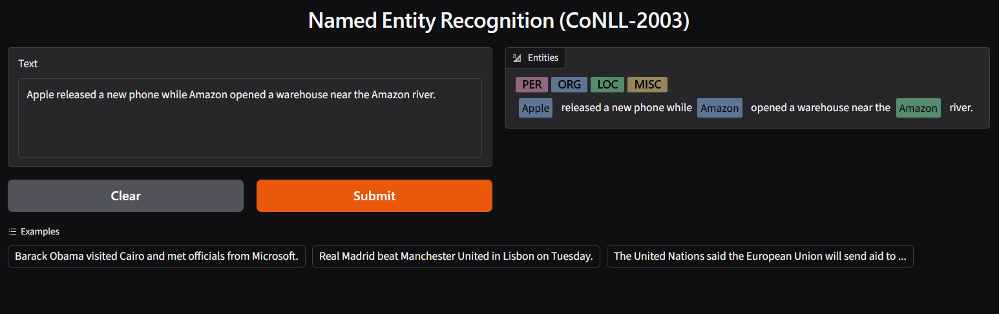

# Named Entity Recognition on CoNLL-2003

A named entity recognition (NER) pipeline that labels people (PER), organizations (ORG), locations (LOC) and miscellaneous entities (MISC) in English text. I built and compared four architectures on CoNLL-2003: an LSTM, a BiLSTM, a BiLSTM with a CRF layer, and a fine-tuned DistilBERT. A fifth variant adds character-level features to the BiLSTM-CRF to handle out-of-vocabulary (OOV) words. The best model is served through a small Gradio app.



## Results

Entity-level micro F1 computed with `seqeval` (single run, seed 42):

| Model | Validation F1 | Test F1 |
|---|---|---|
| LSTM | 0.792 | 0.704 |
| BiLSTM | 0.846 | 0.771 |
| BiLSTM + CRF | 0.855 | 0.783 |
| BiLSTM + CRF + character CNN | 0.911 | 0.855 |
| DistilBERT (cased, fine-tuned) | **0.937** | **0.895** |

Per-entity results for DistilBERT on the test set:

| Entity | Precision | Recall | F1 |
|---|---|---|---|
| LOC | 0.924 | 0.915 | 0.920 |
| MISC | 0.762 | 0.801 | 0.781 |
| ORG | 0.843 | 0.894 | 0.868 |
| PER | 0.951 | 0.948 | 0.950 |
| micro avg | 0.886 | 0.904 | 0.895 |

## What the comparison shows

- **Bidirectional context matters.** Going from LSTM to BiLSTM improved test F1 by about 6.7 points, with the largest gains on ORG and MISC.
- **The CRF mainly improves boundaries, not recall.** Its test F1 gain over the BiLSTM is small (about 1.2 points), so I do not claim a large overall improvement. What it does clearly reduce is invalid tag sequences, such as an `I-` tag that does not follow a `B-` or `I-` tag of the same type. In two earlier unseeded runs, the share of invalid `I-` predictions dropped from roughly 7% (BiLSTM) to roughly 2% (BiLSTM-CRF). The CRF still produced some invalid sequences, because its transition scores are learned and not hard constraints. In one run MISC F1 got worse with the CRF, so the effect is not uniform across entity types.
- **Character features help with unseen words.** About 7.5% of validation tokens are OOV with respect to the training vocabulary. Adding a character CNN (case-sensitive) raised test F1 from 0.783 to 0.855.
- **Pretraining helps most on new data.** DistilBERT beat the best Keras model by 2.6 points on validation and about 4 points on test. A plausible reason is the knowledge from pretraining, but I did not run an experiment to confirm that.
- **Validation scores are higher than test scores for every model** (4 to 9 points). CoNLL-2003 is known for this gap, since the test set contains more unseen names.

## Qualitative observations from the demo

I tested the fine-tuned model on a handful of hand-written sentences (a small, non-systematic sample).

- The same word gets different labels from context: in "Apple released a new phone while Amazon opened a warehouse near the Amazon river", the first *Amazon* is ORG and the second is LOC.
- A company name that did not exist in the 1996 training data (OpenAI, Anthropic) was still recognized as ORG.
- Text in all lowercase (`barack obama visited cairo.`) produced no entities. The model is cased and relies on capitalization.
- In an all-uppercase headline, `NASA` was found but `FLORIDA` was missed.
- Ambiguous sentences such as "Jordan met Washington in Washington." are labeled with lower confidence (Jordan as PER at 0.92).

**An aggregation bug worth noting.** During training, only the first subword of each word receives a label (the other subwords are ignored with `-100`). My first demo used the Hugging Face pipeline with `aggregation_strategy="simple"`, which merged predictions from all subwords, including ones the model was never trained on. *Anthropic* was split into fragments as a result. Switching to `aggregation_strategy="first"`, which matches the training setup, fixed it. The aggregation strategy at inference should match how labels were aligned during training.

## Approach

**Data.** CoNLL-2003 from Hugging Face ([eriktks/conll2003](https://huggingface.co/datasets/eriktks/conll2003), parquet revision): 14,041 / 3,250 / 3,453 sentences for train / validation / test. Tags are already in IOB2 format (9 labels). About 83% of tokens are `O`, so I report entity-level metrics from `seqeval` and not token accuracy.

**Keras models** (`notebooks/ner-keras-lstm-bilstm-crf.ipynb`)
- Sentences padded or truncated to 50 tokens (covers 99.7% of training sentences).
- Embeddings initialized from GloVe 6B 100d (about 88% vocabulary coverage), then fine-tuned.
- 128 recurrent units, dropout 0.3, Adam, batch size 32, early stopping on validation loss.
- The CRF layer (forward algorithm for the loss, Viterbi for decoding) is implemented from scratch, because the `keras-crf` package could not be installed in the environment.
- Character branch: 30-dimensional character embeddings, a 1D convolution with 50 filters (kernel size 3), global max pooling, concatenated with the word embedding. Characters keep their case.

**Transformer** (`notebooks/ner-distilbert-finetuning.ipynb`)
- `distilbert-base-cased` with `AutoModelForTokenClassification` and the `Trainer` API.
- 3 epochs, learning rate 5e-5, batch size 16, weight decay 0.01, fp16. The best epoch is selected by validation F1.
- Labels are aligned to the first subword of each word; other subwords and special tokens are masked.

## Evaluation notes

- All scores come from `seqeval` entity-level micro F1.
- Validation data was used for early stopping and model selection. The test set was evaluated once per model after training.
- Keras models truncate sentences at 50 tokens and DistilBERT at 128 subwords. This affects a very small share of sentences, but the comparison is not perfectly identical for those.
- All numbers are from a single run with one seed. Differences of about one point or less between models should not be treated as reliable.
- No systematic hyperparameter search was done.

## Limitations

- CoNLL-2003 consists of English news text from 1996, so performance on other domains, informal text or recent entities is likely lower.
- The model depends on capitalization and is weak on lowercase or all-caps input.
- MISC is the hardest class (test F1 0.781), and ORG has more false positives than missed entities.

## Demo

The notebook `ner-distilbert-finetuning.ipynb` ends with a Gradio app that highlights detected entities with color-coded spans (PER, ORG, LOC, MISC). The model weights are not included in this repository because of their size (about 263 MB); re-running the notebook recreates them.

## Reproducing the results

The notebooks were run on Kaggle with a GPU (Tesla T4). Internet access must be enabled to download the dataset and the pretrained model.

- Keras notebook: add a GloVe dataset that contains `glove.6B.100d.txt` (I used `rtatman/glove-global-vectors-for-word-representation`) and update `GLOVE_PATH` if the mount path differs.
- The Keras and DistilBERT parts are in separate notebooks. Running TensorFlow and PyTorch in the same session crashed the kernel in my environment.

## Repository structure

```
ner-conll2003/
├── assets/
│   └── demo.png
├── notebooks/
│   ├── ner-keras-lstm-bilstm-crf.ipynb
│   └── ner-distilbert-finetuning.ipynb
├── .gitignore
└── README.md
```

## Author

Asaf Esmat Wagih · [GitHub](https://github.com/asafesmat)
